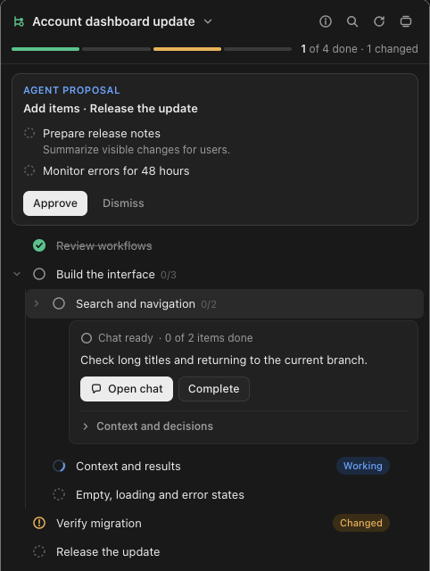
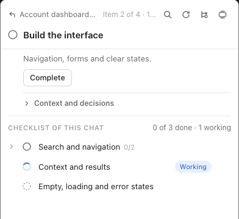

# Chat Tree for Codex and Claude Code

Turn an agreed plan into a nested checklist where every item is its own chat, in Codex Desktop or in the Code tab of Claude Desktop. Open an item and you work in a focused chat that knows its task and its parent; finish it and the result goes back up to the parent chat.

<p>
  
  
</p>

It replaces a flat to-do list, not a task manager: each checkbox is a chat that is not started, ready, working or done.

## Why

You make a plan with the agent and start on the first step. It turns out to have sub-tasks of its own, so you dig into one of them, and that one splits again. A few hours later you have a pile of open chats, and it is hard to tell which one belongs where, what is finished and what was decided along the way.

Chat Tree keeps that work in order. Once the plan for your task is agreed, ask the agent to turn it into a Chat Tree and you get a clean checklist with completion marks. Open the first item: it is a new chat that already knows its task and where it sits in the plan. Do the research there, and if more sub-tasks appear, ask for a Chat Tree again, right in that chat. Nesting can go as deep as the work needs. Every chat keeps its place in the hierarchy and links back to its parent, and when an item is done its result goes up to the parent chat, so you never lose track.

## Install

Both hosts need Python 3.9+ available as `python3` (standard library only). Each host keeps its own trees.

### Codex

Requires Codex Desktop.

```sh
curl -fsSL https://raw.githubusercontent.com/zaartix/codex-chat-tree/main/install.py | python3 -
```

The installer adds the plugin through the Codex plugin manager, asks once whether to trust its four hooks, and tells you to restart Codex. Run the same command again to update. To remove the plugin (saved trees are kept):

```sh
curl -fsSL https://raw.githubusercontent.com/zaartix/codex-chat-tree/main/install.py | python3 - --uninstall
```

Without the installer: `codex plugin marketplace add zaartix/codex-chat-tree`, `codex plugin add chat-tree@chat-tree`, then trust the hooks in Codex settings.

### Claude Code

Requires the Code tab of Claude Desktop: item chats are Desktop sessions. In a terminal-only Claude Code the tree can be read, but item chats cannot be created.

```sh
curl -fsSL https://raw.githubusercontent.com/zaartix/codex-chat-tree/main/install_claude.py | python3 -
```

The installer adds the plugin through the Claude Code plugin manager; new sessions load it. Run the same command again to update, or add `--uninstall` to remove it (saved trees are kept). Without the installer: `claude plugin marketplace add zaartix/codex-chat-tree`, then `claude plugin install chat-tree@chat-tree`.

## Use

1. Discuss a plan with the agent, then say **"Create a Chat Tree from our plan."**
2. Click **Start** on an item (in Claude, ask the agent to start it). In about ten seconds a new chat opens with the parent's project, model, reasoning, permissions and other settings. It starts with the item card and a panel of that item with a link back to its parent; every message there receives the item's context.
3. Work in the item chat. It shows a quiet link to its parent and its own checklist, which can be broken down further in the same way.
4. When the item is done, tell the agent or click **Complete**. Summaries are collected bottom-up, the result is delivered only to the immediate parent, and the item's chat is archived: done means archived. Open it again with one click on **Unarchive and open**; a new message there reopens the item.

The panel is for navigation and completion. Creating, adding, editing, rebuilding and deleting items always goes through the agent, and tree changes happen only on your explicit request or approval. Built-in texts are English; your task data and the chats stay in your language.

To use your own phrase for it, add a rule to your AGENTS.md (Codex) or CLAUDE.md (Claude), for example: `When I ask for a task checklist, use the Chat Tree plugin.`

### In Claude Desktop

The Code tab does not show plugin panels, so Chat Tree works through the agent and Desktop's own sessions:

- **Checklist.** Ask for the tree and the agent shows it as a Markdown checklist; its links open the item chats. An item chat shows its parent path, the item and its nested checklist.
- **Start.** Ask to start an item in the chat of its parent (the root chat for top-level items). The agent creates a Desktop session that inherits the parent's folder, model, effort and permission mode, and the server verifies that they match. The new chat opens with the item card and its checklist.
- **Complete.** Ask to complete an item. Summaries travel between sessions as messages, the result goes to the parent session, and the item's session is archived. Desktop may ask you to approve archiving and always asks before deleting a session.
- **Busy chats.** Chat Tree reads whether a session is working from Claude itself, so an interrupted turn never leaves a chat in an unknown state.

## How it works

These notes describe Codex; in Claude the agent creates, archives, renames and deletes sessions with Desktop's session tools, the server verifies the results in Desktop's records, and one `UserPromptSubmit` hook passes the branch context and binds a new session to its item by the token in its first message.

- **Chats.** The server forks the parent chat before its first turn (`thread/fork`), verifies that every setting was inherited and binds the new chat to the item. If inheritance cannot be verified, creation stops with an error. Codex Desktop shows only turns, so one short opening turn then presents the item: the item card is its message and the agent shows the item panel without starting the task.
- **Hooks.** `UserPromptSubmit` adds the branch context to each message; `Stop`, `Interrupt` and `SessionEnd` record whether a chat is busy. A busy or unknown chat blocks completion, rebuilding and deletion.
- **Data.** Trees are stored in `$CODEX_HOME/chat-tree/tree.sqlite3` (default `~/.codex/chat-tree/`), or `~/.claude/chat-tree/` for Claude, and survive updates and removal. Older data is not migrated: an incompatible database is reported as an error.
- **Archived chats.** A completed item is an archived chat. Archiving an item chat yourself closes that branch without summaries (shown as *Closed*), and a new message in a completed or closed chat reopens it with its ancestors. Desktop only lets its own agent archive, unarchive or rename open chats, so the server lists these changes as `sync` and the agent applies them with native tools on its next Chat Tree call.
- **Numbers.** Every item has a hierarchical number (`2.3.5`), and item chat names start with it, e.g. `[2.3] Title`.
- **Deleted chats.** When a linked chat is deleted in Codex, its item and the whole branch below it leave the tree the next time the tree is shown; deleting the root chat removes the tree. Chats of removed sub-items stay in Codex. Archived chats are kept, and branches in the middle of an operation are left to it.
- **Moves.** Only branches without chats can be moved, because an existing chat keeps the settings of the parent it was forked from; a started branch is rebuilt instead.

Remote environments have not been verified.

## Development

```sh
git clone https://github.com/zaartix/codex-chat-tree && cd codex-chat-tree
python3 -m unittest discover -s tests   # tests
python3 preview.py                      # panel preview with isolated data
python3 install.py                      # install this checkout into Codex, then restart Codex
python3 install_claude.py               # run this checkout in Claude Code; new sessions load changes
python3 release.py 0.3.0                # test, bump version, commit, tag and push
```

- The preview serves `plugins/chat-tree/assets/tree.html` on every reload; `?chat=<id>` shows the panel as another chat.
- In Codex, every new `tree_panel` call mounts the current HTML. Python and tool changes need a Codex restart.
- `install.py` from a checkout installs that checkout; from GitHub it installs the latest `main`. Switching between them replaces the other source.
- The Codex plugin is `plugins/chat-tree/`; the Claude plugin is the repository root with its files in `claude/`, running the same code.
- `release.py` sets one version in both manifests; the Codex version also names the panel resource.

## License

MIT
